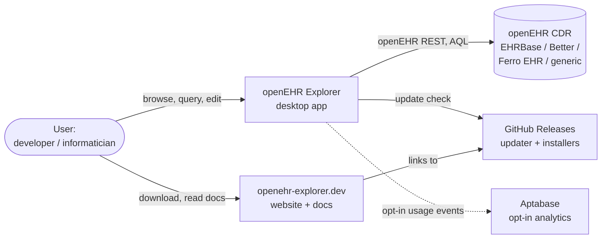
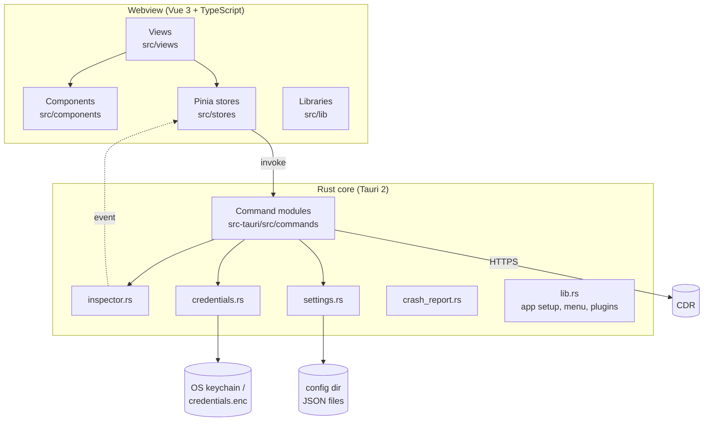
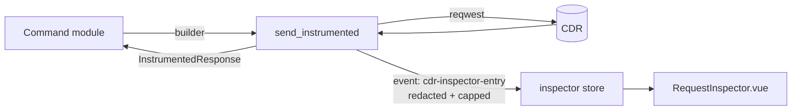
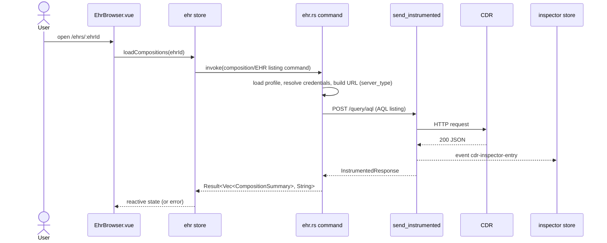
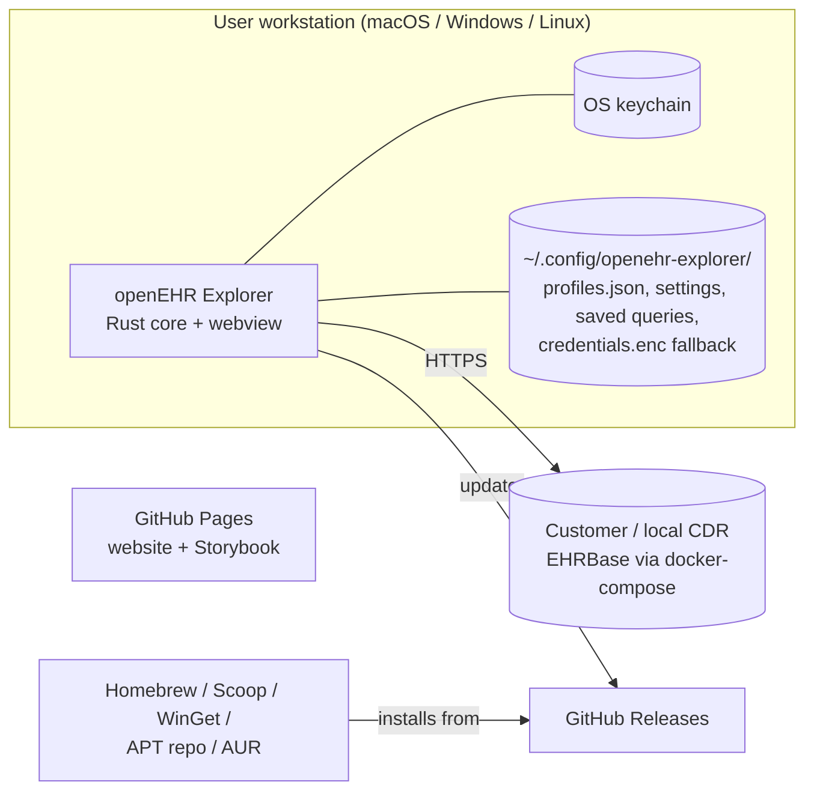
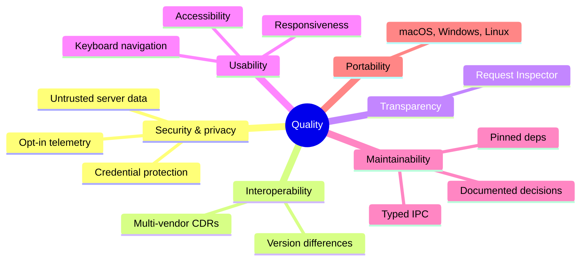

# openEHR Explorer — Architecture Documentation (arc42)

**Version:** 0.10.x · **Template:** [arc42](https://arc42.org) (v8, English)

This document describes the architecture of openEHR Explorer. It complements the
product requirements in [`docs/prd/`](../prd/) (what/why) and the decision
records in [`docs/adr/`](../adr/) (individual technical decisions); arc42 ties
them together into one navigable overview. Diagrams use [Mermaid](https://mermaid.js.org),
which GitHub renders inline.

> **Maintenance:** When a change alters a building block, interface, or
> cross-cutting concept described here, update the relevant section in the same
> PR. Record the *reason* for significant decisions as an ADR and link it from
> section 9.

## Contents

1. [Introduction and Goals](#1-introduction-and-goals)
2. [Architecture Constraints](#2-architecture-constraints)
3. [Context and Scope](#3-context-and-scope)
4. [Solution Strategy](#4-solution-strategy)
5. [Building Block View](#5-building-block-view)
6. [Runtime View](#6-runtime-view)
7. [Deployment View](#7-deployment-view)
8. [Cross-cutting Concepts](#8-cross-cutting-concepts)
9. [Architecture Decisions](#9-architecture-decisions)
10. [Quality Requirements](#10-quality-requirements)
11. [Risks and Technical Debt](#11-risks-and-technical-debt)
12. [Glossary](#12-glossary)

---

## 1. Introduction and Goals

openEHR Explorer is a cross-platform desktop application (macOS, Windows, Linux)
for browsing, querying, and inspecting openEHR Clinical Data Repository (CDR)
instances such as EHRBase and Better Platform. It is positioned as a "Postman
alternative built specifically for openEHR" (see [PRD-0001](../prd/PRD-0001-openehr-explorer-desktop-cdr-browser.md)).

### 1.1 Requirements Overview

| Capability | Description | PRD |
|---|---|---|
| Server profiles | Save/switch multiple CDRs, auto-detect server type and version | PRD-0001, PRD-0004, PRD-0014 |
| EHR & composition browsing | Paginated EHR list, composition grouping, search | PRD-0001, PRD-0013 |
| Composition viewer | Pretty (template-aware), JSON, and FLAT views; FLAT path panel | PRD-0001, PRD-0010 |
| Composition/EHR CRUD | Create, edit, delete via medblocks-ui forms | PRD-0003 |
| Template browser | Web Template tree, OPT XML, upload, lifecycle indicator | PRD-0008, PRD-0009, PRD-0017 |
| AQL runner | Editor with autocomplete, tabular results, saved queries, CSV export | PRD-0006 |
| Request Inspector | Raw HTTP request/response log, copy as curl | PRD-0005 |
| Terminology awareness | Resolve terminology codes | PRD-0012 |
| Settings, shortcuts, tour | Global settings, keyboard navigation, feature tour / what's new | PRD-0011, PRD-0015, PRD-0018 |
| Distribution | Signed installers, in-app updates, opt-in analytics, product website | PRD-0002, PRD-0007, PRD-0016 |

### 1.2 Quality Goals

The top quality goals, in priority order (details and scenarios in [section 10](#10-quality-requirements)):

| # | Goal | Motivation |
|---|---|---|
| 1 | **Security & privacy** | Tool is used near clinical data; credentials must never leak, analytics must be opt-in |
| 2 | **Interoperability** | Must work across CDR vendors whose REST APIs deviate from the openEHR spec |
| 3 | **Transparency / debuggability** | The product's value is showing exactly what goes over the wire |
| 4 | **Usability** | Fast, keyboard-friendly, native-feeling desktop UX; large datasets stay responsive |
| 5 | **Maintainability** | Small, mostly volunteer-driven team; reproducible builds, strong typing, documented decisions |

### 1.3 Stakeholders

| Role | Expectation |
|---|---|
| openEHR developers / integrators (primary users) | Inspect data, run AQL, copy FLAT paths and curl commands without leaving one tool |
| Clinical-informatics / modelling staff | Browse templates and archetype structure, verify compositions |
| CDR operators | Safe, read-mostly access; no surprises on production servers |
| Contributors / maintainers | Clear structure, conventions, CI that catches regressions |
| Security / compliance reviewers | Verifiable credential handling, CSP, signed binaries |

---

## 2. Architecture Constraints

### 2.1 Technical

| Constraint | Background |
|---|---|
| **Tauri 2** (Rust backend + system webview) | Small native footprint, OS integration (keychain, updater, menus); see [PRD-0001](../prd/PRD-0001-openehr-explorer-desktop-cdr-browser.md) |
| **Vue 3 + TypeScript + Pinia** frontend | Composition API, `<script setup>`; Vite as build tool |
| **All CDR HTTP traffic goes through Rust** (`reqwest`) | Avoids webview CORS limits, enables central instrumentation and credential isolation ([ADR-0011](../adr/ADR-0011-centralized-request-instrumentation.md)) |
| **openEHR REST API** as the integration contract | Vendor deviations handled per `server_type` |
| **Pinned dependency versions** | Reproducible builds ([ADR-0007](../adr/ADR-0007-pinned-dependency-versions.md)) |
| **No bundled backend service** | Application is a pure client; it owns no server-side state |

### 2.2 Organizational

| Constraint | Background |
|---|---|
| Open source, Apache-2.0 | Public GitHub repo `platzhersh/openehr-explorer` |
| PRD/ADR governance | [ADR-0001](../adr/ADR-0001-use-prd-and-adr-documentation.md) |
| Conventional Commits, PR-based workflow | See `CLAUDE.md` / `CONTRIBUTING.md` |
| Tag-triggered releases | See [`RELEASING.md`](../../RELEASING.md) |

### 2.3 Conventions

- Lint/format: `oxlint` / `oxfmt` (frontend), `cargo fmt` / `cargo clippy -D warnings` (Rust).
- Type check with `vue-tsc`; unit tests with Vitest (frontend) and `cargo test` (backend).
- Components documented in Storybook ([ADR-0021](../adr/ADR-0021-storybook-for-component-development.md)); WCAG AA colour contrast enforced ([ADR-0028](../adr/ADR-0028-color-contrast-gate.md)).
- No text-glyph carets; use `CaretIcon` / `CollapsibleSection` (enforced by test).

---

## 3. Context and Scope

### 3.1 Business Context

| Partner | Inputs / Outputs |
|---|---|
| **User** | Interactive UI; provides server URL and credentials, AQL, form data |
| **openEHR CDR** | Receives REST calls (EHR, composition, template, query, contribution, directory); returns JSON/XML. Responses are untrusted input |
| **GitHub Releases** | Serves `latest.json` updater manifest and signed installers |
| **Aptabase** | Receives anonymous, opt-in usage events (no PII) — [ADR-0018](../adr/ADR-0018-aptabase-opt-in-usage-analytics.md) |
| **Website** | Separate Astro + Vue static site, deployed via GitHub Pages — [ADR-0024](../adr/ADR-0024-astro-vue-marketing-site.md) |

### 3.2 Technical Context

| Channel | Protocol | Notes |
|---|---|---|
| Webview ⇄ Rust | Tauri IPC (`invoke`) and Tauri events | Typed command signatures; `cdr-inspector-entry`, `check-for-updates-requested` events |
| Rust → CDR | HTTP(S) via `reqwest`; Basic/Bearer/none auth | Base path from `profile.api_root()`; vendor admin endpoints off `base_url` |
| Rust → OS | Keychain (`keyring`), config dir files, native menu, dialogs | Encrypted-file fallback where no keychain exists |
| Webview → CDN | HTTPS (unpkg, jsDelivr) | medblocks-ui and a few assets, with SRI ([ADR-0008](../adr/ADR-0008-cdn-based-medblocks-ui.md), [ADR-0016](../adr/ADR-0016-csp-and-subresource-integrity.md)) |
| App → GitHub | HTTPS | Tauri updater, minisign-verified |

**Out of scope:** the application does not persist or cache clinical data, does
not implement a CDR, and does not provide multi-user features.

---

## 4. Solution Strategy

| Goal / problem | Strategy | Where |
|---|---|---|
| Avoid CORS and keep secrets out of the webview | All CDR calls are made by Rust commands; the frontend only invokes commands | §5.2, ADR-0011 |
| Show the wire-level truth | Single `send_instrumented()` wrapper emits an event per request; Inspector store listens | §8.2, ADR-0011 |
| Cope with vendor differences | `ServerType` enum + `api_path_prefix` on each profile; URL building branches on type; AQL used for listing where REST has no list endpoint | §8.3, ADR-0010 |
| Protect credentials | OS keychain with encrypted-file fallback; secrets never in `profiles.json`; redacted in Inspector | §8.1, ADR-0015 |
| Contain XSS from hostile server data | Input validation, escaped rendering, strict CSP, SRI | §8.1, ADR-0014, ADR-0016 |
| Keep the UI maintainable | One Pinia store per domain; views compose reusable, Storybook-documented components | §5.3, ADR-0004 |
| Consistent errors | Three-layer error handling (Rust → store → view) | §8.4, ADR-0005 |
| Keep types honest across the IPC boundary | End-to-end type safety (Rust `serde` structs mirrored by TS interfaces) | ADR-0006 |
| Large result sets stay responsive | Virtualized list rendering | ADR-0023 |
| Trustworthy distribution | Tag-driven CI/CD, Tauri updater, code signing, VirusTotal scan | §7, ADR-0017/0019/0029 |

---

## 5. Building Block View

### 5.1 Level 1 — Whitebox: openEHR Explorer

| Building block | Responsibility |
|---|---|
| **Frontend (webview)** | Presentation, navigation, client state; no direct CDR access |
| **Rust core** | CDR communication, persistence, secrets, native integration, instrumentation |
| **Website** (`website/`) | Static marketing + documentation site; shares the Storybook bundle ([ADR-0026](../adr/ADR-0026-shared-storybook-app-and-website.md)); not part of the shipped app |
| **CI/CD & packaging** (`.github/workflows`, `packaging/`, `scripts/`) | Build, sign, publish, and update-manifest pipelines |

### 5.2 Level 2 — Rust Core

| Module | Responsibility |
|---|---|
| `lib.rs` | `run()`: credential migration, crash-report consent seeding, plugin registration (opener, http, dialog, fs, updater, process, aptabase), native menu, `generate_handler![]` command registry |
| `commands/server.rs` | Profile CRUD, connection test, server-type/version detection, plaintext-credential migration. Owns `ServerProfile`, `ServerType`, `AuthMethod`, `api_root()` |
| `commands/ehr.rs` | EHR list/detail/create/delete/search (AQL-based per ADR-0010/0027) |
| `commands/composition.rs` | Composition get (structured, FLAT, versions), create, update, delete |
| `commands/template.rs` | Template list, Web Template fetch, OPT XML get/upload |
| `commands/query.rs` | AQL execution, saved-query storage |
| `commands/terminology.rs` | Code lookups with `TerminologyCache` |
| `commands/contribution.rs` | Contribution audit-trail retrieval ([ADR-0020](../adr/ADR-0020-contribution-audit-trail-view.md)) |
| `commands/dashboard.rs` | Aggregated counts and server info for the landing dashboard |
| `inspector.rs` | `send_instrumented()`: capture, redact, cap (2 MB), emit `cdr-inspector-entry` |
| `credentials.rs` | `CredentialStore`: keychain primary, AES-GCM encrypted file fallback, file-permission hardening, zeroization |
| `settings.rs` | Persisted app settings (analytics consent, etc.) |
| `crash_report.rs` | Consent-gated panic hook |

**Interface to the frontend:** `#[tauri::command] async fn(...) -> Result<T, String>`.
Every command that talks to a CDR receives the `AppHandle` so it can call
`send_instrumented`.

### 5.3 Level 2 — Frontend

| Area | Contents |
|---|---|
| **Views** (`src/views`) | `Dashboard`, `EhrBrowser`, `CompositionViewer`, `CompositionForm`, `ContributionViewer`, `TemplateBrowser`, `AqlRunner`, `TerminologyBrowser`, `ServerManager`, `Settings` |
| **Routing** (`src/main.ts`) | `/dashboard`, `/ehrs[/:ehrId[/compositions/:uid \| /contributions/:uid]]`, `/templates[/:id]`, `/aql`, `/terminology`, `/servers`, `/settings`, `/compose/:templateId[/:ehrId]`, `/edit/:ehrId/:uid` |
| **Stores** (`src/stores`) | `server`, `ehr`, `composition`, `contribution`, `template`, `query`, `dashboard`, `settings`, `inspector`, `update`, `tour`, `whatsNew` — one per domain ([ADR-0004](../adr/ADR-0004-separate-pinia-stores-per-domain.md)) |
| **Components** (`src/components`) | Shared UI: `AppSidebar`, `RequestInspector`, `CompositionTree`, `JsonViewer`/`XmlViewer`/`BashViewer` ([ADR-0021](../adr/ADR-0021-harmonized-json-viewer-component.md), [0022](../adr/ADR-0022-harmonized-xml-viewer-component.md)), `AqlEditor` (CodeMirror, [ADR-0012](../adr/ADR-0012-codemirror-for-aql-editor.md)), `DirectoryTree`, icons, buttons; each with a Storybook story |
| **Libraries** (`src/lib`) | Pure logic: `webtemplate.ts` (tree traversal, FLAT paths), `aql/` (autocomplete), `terminology.ts`, `apiPath.ts`, `virtualList.ts`, `xml.ts`, `tours.ts`, `whats-new.ts`, `errorReport.ts`, `navShortcuts.ts` |

**Rule of dependency:** views → stores/components/lib; stores → Tauri `invoke`/events;
components never call `invoke` directly (they receive props/emit events), which
keeps them Storybook-renderable with `storybook-tauri.ts` mocks.

### 5.4 Level 3 — Request Instrumentation (`inspector.rs`)

---

## 6. Runtime View

### 6.1 Startup

1. `run()` migrates any plaintext credentials from `profiles.json` into secure storage.
2. Crash-report consent is read from settings and mirrored into the panic hook's flag.
3. Plugins and the native menu are registered; the Aptabase plugin is a no-op when no app key was compiled in or consent is absent.
4. The webview loads; stores hydrate (`settings`, `server` → active profile). The updater store performs a startup check.

### 6.2 Browse an EHR's compositions

### 6.3 Create a composition from a template

1. User opens `/compose/:templateId/:ehrId`; `template` store fetches the Web Template.
2. `CompositionForm` renders the template with medblocks-ui (loaded from CDN with SRI).
3. On submit the `composition` store invokes the create command; Rust POSTs the composition and parses the new UID from the `Location` header ([ADR-0009](../adr/ADR-0009-location-header-parsing-for-resource-creation.md)).
4. Store navigates to the viewer; errors surface via the three-layer strategy.

### 6.4 Run an AQL query

`AqlRunner` → `query` store → `execute_aql` command → CDR `/query/aql` → rows/columns
returned and rendered as a (virtualized) table; CSV export is client-side; saved
queries are persisted by Rust. Autocomplete combines keyword, template-path, and
archetype-aware suggestions in the `aql/` library.

### 6.5 Save a server profile

`ServerManager` → `server` store → server-profile save command. Rust splits the profile:
non-secret fields go to `profiles.json`; password/token go to `CredentialStore`
(keychain, else encrypted file). Frontend receives profiles without secrets.

### 6.6 Update check

Startup or menu "Check for Updates…" (`check-for-updates-requested` event) → `update`
store → Tauri updater fetches `latest.json` from GitHub Releases, verifies the
minisign signature, downloads, installs, restarts ([ADR-0017](../adr/ADR-0017-tauri-updater-with-github-releases.md)).

---

## 7. Deployment View

### 7.1 Infrastructure

The app is a single self-contained installable per platform. It requires no
server infrastructure; the CDR is the user's own. `docker-compose.yml` provides
a local EHRBase for development ([`LOCAL_TESTING.md`](../../LOCAL_TESTING.md)).

### 7.2 Build and release pipeline

`ci.yml` runs frontend checks (lint, format, `vue-tsc`, Vitest, build, Storybook + contrast gate)
and Rust checks (fmt, clippy `-D warnings`, tests) on every push/PR, plus a macOS build.
Pushing a `v*` tag triggers:

| Job | Output |
|---|---|
| `build-macos` / `build-windows` / `build-linux` | Installers (DMG, MSI/NSIS, AppImage/deb/rpm); Windows signed via SignPath ([ADR-0029](../adr/ADR-0029-signpath-code-signing.md)) |
| `publish-updater-manifest` | `latest.json` for the Tauri updater |
| `publish-homebrew-cask`, `publish-scoop-bucket`, `winget.yml`, `apt-repo.yml` | Package-manager distribution |
| VirusTotal submission | Reputation scan ([ADR-0019](../adr/ADR-0019-virustotal-scan-submission.md)) |
| `pages.yml` | Website + Storybook deployment |

Details: [`RELEASING.md`](../../RELEASING.md).

### 7.3 Local data

| Data | Location | Sensitivity |
|---|---|---|
| Server profiles (no secrets) | `<config>/openehr-explorer/profiles.json` | Medium (URLs) |
| Secrets | OS keychain, else `credentials.enc` (AES-GCM, key file `.key`, hardened permissions) | High |
| Settings, saved queries | JSON in the config dir | Low |
| Clinical data | **Never persisted**; held in memory only while displayed | High |

---

## 8. Cross-cutting Concepts

### 8.1 Security

- **Credentials:** keychain-first storage, encrypted-file fallback, zeroization, never returned to the frontend, `Authorization`/`Cookie` redacted in the Inspector ([ADR-0015](../adr/ADR-0015-secure-credential-storage.md), [ADR-0011](../adr/ADR-0011-centralized-request-instrumentation.md)).
- **Hostile server data:** treat CDR responses as untrusted; escape on render; validate user input ([ADR-0014](../adr/ADR-0014-xss-hardening-and-input-validation.md)).
- **CSP + SRI:** CSP in `tauri.conf.json` limits script/style sources; CDN assets pinned with SRI ([ADR-0016](../adr/ADR-0016-csp-and-subresource-integrity.md)). `connect-src` permits arbitrary `http(s)` because users add arbitrary CDR URLs — mitigated because CDR traffic is made from Rust, not the webview.
- **Supply chain:** pinned dependencies + committed lockfiles, signed updater artifacts, code-signed Windows installer.
- **Privacy:** analytics and crash reporting are opt-in, contain no PII ([ADR-0018](../adr/ADR-0018-aptabase-opt-in-usage-analytics.md)).

### 8.2 Observability: Request Inspector

All CDR traffic is observable via the event pipeline in §5.4. Any new CDR call
**must** use `send_instrumented` rather than calling `.send()` directly.

### 8.3 Vendor abstraction

`ServerProfile.server_type` (`ehrbase | better_platform | ferro_ehr | generic`) and
`api_path_prefix` isolate vendor differences. Rules:

- Build openEHR URLs from `profile.api_root()`; never hardcode `/rest/openehr/v1`.
- Vendor-specific non-openEHR endpoints (e.g. EHRBase `/rest/admin`, `/rest/status`) hang off `base_url`.
- Where the spec lacks an endpoint (EHR listing), use AQL ([ADR-0010](../adr/ADR-0010-aql-based-listing-for-ehr-and-composition.md)); know its limits ([ADR-0027](../adr/ADR-0027-ehr-level-attribute-aql-limitations.md)).
- Version detection informs feature availability (PRD-0014).

### 8.4 Error handling

Three layers ([ADR-0005](../adr/ADR-0005-three-layer-error-handling.md)): Rust commands return contextual `Err(String)`;
stores catch, store `error` state, and map to user-friendly text; views render
`DismissibleError`. Unexpected frontend errors are reported only with analytics consent, via `errorReport.ts`, which sends a bounded error class and scrubbed `file:line` — never messages (they may contain URLs, EHR IDs or AQL).

### 8.5 State management and persistence

Pinia (composition style) per domain; the Rust side is the single source of truth
for persisted state (profiles, settings, saved queries). The frontend uses `localStorage` only for minor UI conveniences (e.g. Inspector panel and form preferences), never for domain data.

### 8.6 Type safety

Rust `serde` structs are mirrored by TypeScript interfaces in stores
([ADR-0006](../adr/ADR-0006-end-to-end-type-safety.md)). Changing a command's
payload requires changing both sides in one PR.

### 8.7 Performance

Large lists (EHRs, compositions, query rows) use virtualized rendering
([ADR-0023](../adr/ADR-0023-virtualized-list-rendering-for-large-data-views.md));
response bodies in the Inspector are capped at 2 MB; terminology lookups are cached.

### 8.8 UI consistency and accessibility

Shared viewers/buttons/icons, tokens in `src/styles/tokens.css`, WCAG AA contrast
gate ([ADR-0028](../adr/ADR-0028-color-contrast-gate.md)), no opacity-dimmed text,
keyboard navigation (`navShortcuts.ts`, PRD-0015), `aria-expanded` on disclosures.

### 8.9 Testing

| Level | Tooling |
|---|---|
| Frontend unit | Vitest (`*.test.ts` next to sources, e.g. `webtemplate`, `virtualList`, `contrast`) |
| Component / visual | Storybook stories + axe-core contrast run in CI |
| Backend unit | `cargo test` (credentials, URL building, parsing) |
| Static | `vue-tsc`, oxlint, clippy |
| Manual / integration | Local EHRBase via `docker-compose` |

### 8.10 Documentation

PRDs, ADRs, this arc42 document, README/website docs, Storybook ([ADR-0001](../adr/ADR-0001-use-prd-and-adr-documentation.md)).

---

## 9. Architecture Decisions

All decisions live in [`docs/adr/`](../adr/). Grouped by concern:

| Concern | ADRs |
|---|---|
| Governance | 0001 PRD/ADR docs, 0007 pinned versions |
| Frontend structure | 0002 medblocks-ui forms, 0003 dialog pattern for CRUD, 0004 store per domain, 0008 CDN medblocks-ui, 0012 CodeMirror AQL editor, 0021 JSON viewer, 0022 XML viewer, 0023 virtualized lists, 0025 codeblock copy |
| Backend / integration | 0005 error handling, 0006 end-to-end types, 0009 Location-header parsing, 0010 AQL-based listing, 0011 request instrumentation, 0013 OPT term-binding normalisation, 0020 contribution audit trail, 0027 EHR attribute AQL limits |
| Security & privacy | 0014 XSS hardening, 0015 credential storage, 0016 CSP + SRI, 0018 opt-in analytics |
| Delivery | 0017 Tauri updater, 0019 VirusTotal, 0029 SignPath signing |
| Quality tooling | 0021 Storybook, 0028 contrast gate |
| Website | 0024 Astro + Vue site, 0026 shared Storybook/website |

---

## 10. Quality Requirements

### 10.1 Quality Tree

### 10.2 Quality Scenarios

| ID | Scenario | Expected response |
|---|---|---|
| Q1 | A profile with Basic auth is saved | `profiles.json` contains no password; secret is in keychain or `credentials.enc` |
| Q2 | A CDR returns HTML/script in a field value | Rendered as text; no script execution; CSP blocks inline injection from external origins |
| Q3 | A request is sent with a bearer token | Inspector shows the request with `Authorization: [REDACTED]` |
| Q4 | User connects to a CDR of an unknown vendor | Works via `generic` type with configurable `api_path_prefix` |
| Q5 | A query returns tens of thousands of rows | UI remains scrollable (virtualization); Inspector body capped at 2 MB |
| Q6 | A new CDR endpoint is added | Only a Rust command + store action required; automatically visible in the Inspector |
| Q7 | A user has not consented to analytics | No events leave the machine; crash reports are not sent |
| Q8 | A release is tagged | All three platform builds, updater manifest and package-manager updates are produced without manual steps |
| Q9 | A theme colour change reduces contrast below AA | CI contrast test / axe gate fails |
| Q10 | CDR is unreachable | User sees an actionable error within the HTTP timeout; app stays usable |

---

## 11. Risks and Technical Debt

| # | Item | Impact | Mitigation / next step |
|---|---|---|---|
| R1 | **Vendor API drift** — CDRs change or deviate from the spec | Broken listings/CRUD for some versions | `server_type` branching, version detection, local EHRBase for testing; broaden CDR test matrix |
| R2 | **CDN dependency for medblocks-ui** ([ADR-0008](../adr/ADR-0008-cdn-based-medblocks-ui.md)) | Composition forms unavailable offline; CDN compromise risk | SRI + CSP today; consider vendoring the bundle |
| R3 | **CSP allows `unsafe-inline` and broad `connect-src`** | Weaker XSS containment | Documented trade-off; CDR traffic stays in Rust; tighten when forms no longer require inline scripts |
| R4 | **AQL-based EHR listing** has limits ([ADR-0027](../adr/ADR-0027-ehr-level-attribute-aql-limitations.md)) | Filters on some EHR attributes unavailable on some CDRs | Documented; revisit when vendors expose list endpoints |
| R5 | **Encrypted-file credential fallback** keeps its key next to the data | Weaker than keychain on systems without one | File permission hardening; keychain preferred; document in security notes |
| R6 | **Hand-mirrored Rust/TS types** | Drift between backend and frontend | Review discipline; consider generating TS types (e.g. `ts-rs`/`specta`) |
| R7 | **Duplicate ADR number 0021** (JSON viewer and Storybook) | Ambiguous references | Renumber or disambiguate in a follow-up; references in this document name the topic |
| R8 | **Small maintainer team**, many release channels | Release toil, signing-service dependency | Automated tag-driven pipelines; `RELEASING.md` |
| R9 | **Write operations against real CDRs** | Accidental data modification | Explicit confirmation dialogs ([ADR-0003](../adr/ADR-0003-dialog-component-pattern-for-crud.md)); consider a per-profile read-only mode |

---

## 12. Glossary

| Term | Definition |
|---|---|
| **openEHR** | Open standard for health data specification, with archetype-based modelling |
| **CDR** | Clinical Data Repository — server storing openEHR data (EHRBase, Better, …) |
| **EHR** | Electronic Health Record — per-subject container identified by `ehr_id` |
| **Composition** | Unit of clinical documentation within an EHR, based on a template |
| **Archetype / Template** | Reusable clinical model / use-case-specific constraint of archetypes |
| **OPT** | Operational Template (XML) |
| **Web Template** | JSON simplification of an OPT used to build UIs and FLAT paths |
| **FLAT format** | Denormalised key/value composition representation used by SDKs |
| **AQL** | Archetype Query Language |
| **Contribution** | Atomic change set recorded by the CDR (audit trail) |
| **Server profile** | Saved connection definition: URL, `server_type`, auth, optional API path prefix |
| **Tauri** | Rust framework for desktop apps with a system webview |
| **IPC / `invoke`** | Tauri mechanism by which the webview calls Rust commands |
| **Request Inspector** | In-app log of raw HTTP traffic to the CDR |
| **medblocks-ui** | Web-component library used to render composition forms |
| **ADR / PRD** | Architecture Decision Record / Product Requirements Document |
| **arc42** | Template for architecture documentation (<https://arc42.org>) |
